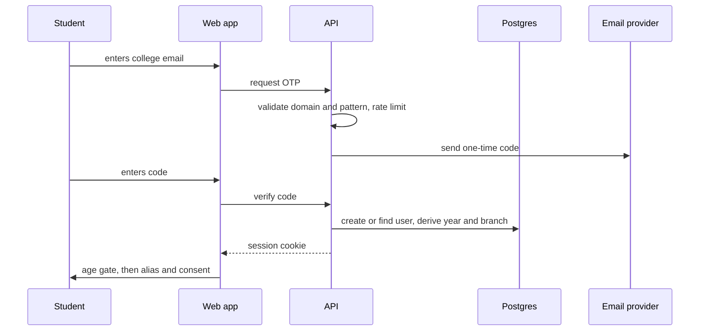
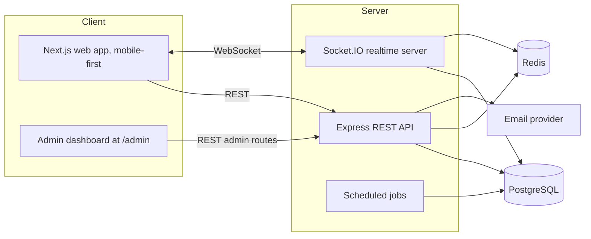
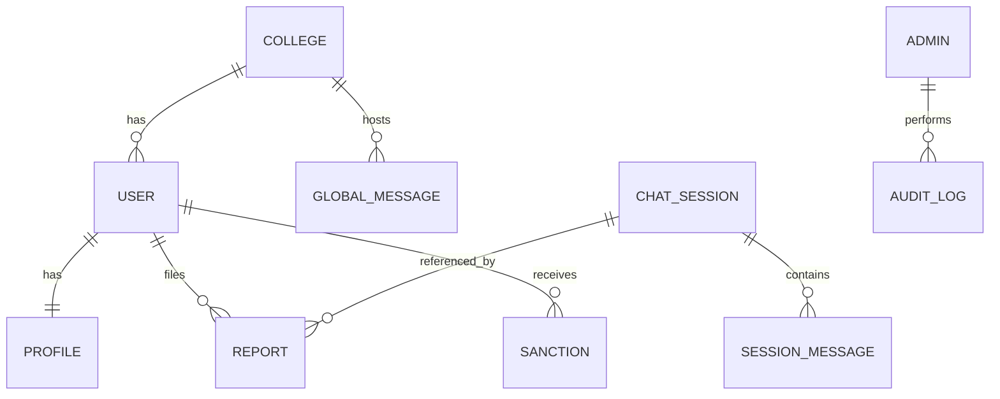

# Campus Anonymous Chat

A verified, anonymous, **text-only** chat platform for college students. Only students with a valid college email can enter, everyone appears under a random alias, and the platform is built **multi-tenant from day one** so that a second campus is a configuration change, not a rewrite.

> **Status:** prototype in planning. This repository starts as a specification. The build is driven by the prompt pack in [`docs/BUILD_PROMPTS.md`](docs/BUILD_PROMPTS.md).
> **Working title:** rename freely. Nothing in the design depends on the name.

---

## Table of contents

1. [What it is](#1-what-it-is)
2. [Scope of the prototype](#2-scope-of-the-prototype)
3. [Design principles](#3-design-principles)
4. [Features](#4-features)
5. [Admin dashboard](#5-admin-dashboard)
6. [How verification works](#6-how-verification-works)
7. [Architecture](#7-architecture)
8. [Data model](#8-data-model)
9. [Matching and realtime design](#9-matching-and-realtime-design)
10. [Moderation and reporting](#10-moderation-and-reporting)
11. [Privacy and data retention](#11-privacy-and-data-retention)
12. [Security checklist](#12-security-checklist)
13. [Legal and compliance (India)](#13-legal-and-compliance-india)
14. [Developer setup (planned)](#14-developer-setup-planned)
15. [Environment variables](#15-environment-variables)
16. [Roadmap](#16-roadmap)
17. [Contributing and repository hygiene](#17-contributing-and-repository-hygiene)
18. [Disclaimer](#18-disclaimer)

---

## 1. What it is

| Piece | Description |
|---|---|
| **Global chat** | One live room per college. Every verified student can read and post. |
| **Random 1-on-1 chat** | Press "Find someone" and be paired with another waiting student from the same college. Text only. |
| **Year filter** | Match with any year, the same year, or specific years. |
| **Block and report** | One tap during a chat, and also for a limited time after it ends. |
| **Admin dashboard** | Report queue, user and ban management, live moderation, word lists, college configuration and an audit log. |

Anonymity here means **anonymous to other users**. The platform itself can link an account to a college email, and the Privacy Policy must say so plainly.

## 2. Scope of the prototype

| In scope (v0.1) | Deliberately out of scope |
|---|---|
| College email login with OTP | Video or voice calls |
| Email pattern parsing (year, branch, programme) | Gender collection and gender filters |
| Date-of-birth age gate (stores only an 18+ flag) | ID card photo scanning |
| Global chat | Images, files and links in chat |
| Random 1-on-1 text chat with year filter | Cross-college matching |
| Block, report, recent-chats reporting | Native mobile apps (the web app is mobile-first) |
| Automated filters and rate limits | Payments, ads, premium features |
| Admin dashboard with audit log | Public profiles, followers, feeds |

Possible later upgrades (see [Roadmap](#16-roadmap)): ID card **QR** age verification, topic rooms, appeals, and video with consent and detection.

## 3. Design principles

1. **Anonymous to peers, honest about the platform.** Never claim "untraceable".
2. **Collect the minimum.** No real name, no photo, no gender, no stored date of birth.
3. **Text only.** Removing images and video removes a large class of abuse and legal risk.
4. **18+ only.** Enforce it at sign-up and act immediately when a minor is found.
5. **Everything per college.** Domains, email patterns, programme lengths and rules live in the database, not in code.
6. **Safety is a feature.** Reporting, blocking, rate limits and moderation ship before growth features.
7. **Auditable admin power.** Every moderator action is logged. Nobody can silently unmask a user.

## 4. Features

### Student-facing

- **Sign-in** with a college email and a one-time code (no passwords).
- **Age gate:** enter a date of birth; under-18 is blocked and nothing is stored.
- **Alias:** a random alias such as `SilverFox27`, optionally rotated daily.
- **Consent screen:** plain-language notice of what is stored and why, plus acceptance of Terms and Community Guidelines (versioned and recorded).
- **Global chat:** live messages, presence count, report and block per message.
- **1-on-1 chat:** find, skip, end, typing indicator, block, report.
- **Recent chats:** report someone for up to 72 hours after a chat ended.
- **Settings:** year preference, blocked users, regenerate alias, delete account, download my data.
- **Safety nudges:** a banner at the start of every chat, and a support card with helpline information when self-harm language is detected.

### Limits that protect users

- Maximum message length and a per-user rate limit.
- Phone numbers, emails and links are blocked in messages.
- Cooldowns for rapid skipping and repeated blocking.
- Repeat offenders are banned by account, email hash and device hash.

## 5. Admin dashboard

The dashboard is a separate route group (`/admin`) with its own layout and its own API router, protected by role-based access.

| Area | What it does |
|---|---|
| **Overview** | Users online, new sign-ups, messages per day, open reports, average time to resolve. |
| **Report queue** | Prioritised list. Severe categories (threats, self-harm, sexual content, suspected minors) appear first. Opens a locked transcript. |
| **Actions** | Dismiss, warn, mute 24 hours, suspend 7 days, permanent ban, mark as suspected minor (deletes the account). Every action needs a reason. |
| **Users** | Look up by alias or internal ID. Shows status, report history, sanctions and verification level. **Never shows the email by default.** |
| **Email reveal (break-glass)** | Superadmin only, mandatory reason, written to the audit log, and a second-approver step when more than one admin exists. |
| **Global chat moderation** | Live feed with delete, time-out and pin-announcement. |
| **Word lists** | Manage blocked terms, including Hinglish (Hindi written in Latin script) variants and spelling tricks. |
| **College settings** | Domains, student and staff email patterns, programme lengths per branch, retention periods, feature flags. |
| **Audit log** | Read-only, filterable record of every admin action. |

**Roles:** `superadmin` (full access, settings, reveal) and `moderator` (reports, users, chat moderation; no settings, no reveal).

## 6. How verification works

### 6.1 Email pattern

Student addresses carry data. Staff addresses do not follow the student pattern, so a strict pattern check keeps staff out.

| Address type | Shape (generic example) | Result |
|---|---|---|
| Student | `firstname.lastname_branch.hYY@college.ac.in` | Accepted. `branch` is the department, `h` marks honours, `YY` is the joining year. |
| Staff | `firstname.lastname@college.ac.in` | Rejected (no branch or year part). |
| Anything else | Other domains, other shapes | Rejected. |

> The exact pattern, including how non-honours students are written, **must be confirmed with real samples** from every branch and batch before launch. The pattern is stored per college, so fixing it is a data change.

### 6.2 Year of study

```
academicStartYear = (month >= July) ? currentYear : currentYear - 1
yearOfStudy       = academicStartYear - (2000 + YY) + 1
```

- Example: in October 2026, a `25` student is in **year 2**.
- If `yearOfStudy` is greater than the programme length for that branch, the account is **graduated** and deactivated.
- Programme length varies by branch (3 to 5 years) and is stored in the college configuration.
- Lateral-entry students can start in year 2. The prototype allows a one-time manual year correction.

### 6.3 Age gate

1. The user enters a date of birth after the email is verified.
2. The server computes whether the person is 18 or older and stores **only** the boolean and the time of the check. The date itself is discarded and never logged.
3. Under 18: the account is not created, the message is neutral, and an immediate retry is blocked by a cooldown on the email hash and device.
4. The Terms include a declaration of age and the right to remove accounts later found to belong to minors.

Self-declaration is a reasonable first step, not a guarantee. Ask a lawyer whether it is sufficient. The users table carries a `verification_level` field so that ID card QR verification can be added later without redesign.

### 6.4 Login sequence



## 7. Architecture



### Suggested stack

| Layer | Choice | Why |
|---|---|---|
| Language | TypeScript everywhere | One language, shared types and validation. |
| Web | Next.js (App Router), Tailwind CSS | Fast to build, installable as a PWA, mobile-first. |
| API | Node.js, Express, zod validation | Simple and well understood. |
| Realtime | Socket.IO | Rooms, reconnection and acknowledgements built in. |
| Database | PostgreSQL with Prisma | Relational data, migrations, row-level tenant scoping. |
| Queue, rate limits, presence | Redis | Fast matching queue and counters. |
| Email | Nodemailer with Mailpit locally, Resend or SES in production | Easy local testing. |
| Tests | Vitest, Supertest, Playwright | Unit, API and end-to-end. |
| CI | GitHub Actions | Lint, test and build on every pull request. |
| Hosting | An India region (for example AWS Mumbai) | Logs must be kept in India and latency stays low. |

Swap any of these if you prefer. The prompts in `docs/BUILD_PROMPTS.md` state the stack once in a shared context block, so changing it is a single edit.

### Planned repository layout

```
campus-anon-chat/
├── apps/
│   ├── web/            Next.js app (student UI and /admin routes)
│   └── api/            Express API, Socket.IO server, scheduled jobs
├── packages/
│   └── shared/         zod schemas, types, constants, email-parsing module
├── prisma/             schema and migrations
├── docs/
│   ├── BUILD_PROMPTS.md
│   └── Campus_Anonymous_Chat_Blueprint_v2.docx
├── docker-compose.yml  Postgres, Redis, Mailpit
├── .env.example        variable names only, never real values
└── README.md
```

## 8. Data model



| Table | Key fields | Notes |
|---|---|---|
| `colleges` | id, name, domains, student_pattern, staff_pattern, programme_lengths, retention settings, status | One row per campus. This is how the platform scales. |
| `users` (private) | id, college_id, email_encrypted, email_hash, age_verified, verification_level, joining_year, branch, programme, status, created_at | Never exposed through a public endpoint. No DOB, no gender. |
| `profiles` | user_id, alias, alias_rotated_at | The only identity other users see. |
| `preferences` | user_id, year_filter | Used only by the matcher. |
| `consents` | user_id, document, version, accepted_at | Proof of notice and consent. |
| `otp_codes` | email_hash, code_hash, expires_at, attempts | Short-lived and hashed. |
| `global_messages` | id, college_id, user_id, body, created_at, hidden | Public room. |
| `chat_sessions` | id, college_id, user_a, user_b, started_at, ended_at, locked | One row per 1-on-1 chat. |
| `session_messages` | id, session_id, sender_id, body (encrypted), created_at | Auto-deleted after retention unless locked. |
| `reports` | id, reporter_id, reported_id, session_id, reason, priority, status, reviewer_id, resolution | Drives the moderation queue. |
| `blocks` | blocker_id, blocked_id | Applied by the matcher and the chat. |
| `sanctions` | user_id, type, reason, expires_at, device_hash | Mute, suspension, ban. |
| `wordlist` | id, college_id, term, kind | Managed in the admin dashboard. |
| `admins` | id, user_id or email_hash, role, created_at | Role-based access. |
| `audit_log` | id, admin_id, action, target, reason, created_at | Append-only. |

## 9. Matching and realtime design

- **Queue key:** one queue per college. A later cross-college mode only changes the key.
- **Compatibility is two-way.** A and B match only if A's filter accepts B's year **and** B's filter accepts A's year.
- **Exclusions:** blocked pairs (in either direction), banned or muted users, and pairs matched in the last 10 minutes.
- **One active session per user.** A second tab or device cannot start another.
- **Timeouts:** after 25 seconds without a match, offer to widen the filter instead of waiting forever.
- **Disconnects:** a 15-second grace period for reconnection before the session is ended for the other person.
- **Privacy:** the other person's year and branch are never sent to the client. The filter is applied on the server only.
- **Minimum pool:** if a filter would match fewer than a configured number of online users, widen it silently, so a narrow filter cannot reveal who someone is.
- **Message limits:** maximum length, burst limit and a per-session rate limit, enforced on the server.

## 10. Moderation and reporting

### Message pipeline

```
incoming message
  → normalise (case, spacing, look-alike characters)
  → block phone numbers, emails, links
  → wordlist match (including Hinglish variants)
  → toxicity classifier (pluggable interface, stubbed in the prototype)
  → decision: allow / hide pending review / reject
```

### Report lifecycle

1. Chats are stored encrypted on the server, tagged with a session ID.
2. For 72 hours after a chat, the user can open **Recent chats** and report the other person.
3. A report snapshots the relevant messages and **locks the transcript** from auto-deletion.
4. Triage sets priority. Several different reporters within a short window trigger an automatic temporary mute pending review.
5. A moderator reviews the transcript and history (email stays hidden).
6. Action ladder: warning → 24-hour mute → 7-day suspension → permanent ban. Appeals come later.
7. Unreported transcripts are deleted after the retention period.

**Report reasons:** harassment, threats or violence, sexual content, self-harm, hate, spam, suspected minor, impersonation or doxxing, other.

**Self-harm and credible threats** need a written escalation plan, including helpline information (for example Tele-MANAS 14416; verify the number before launch) and a contact at the college.

## 11. Privacy and data retention

| Data | Kept for | Notes |
|---|---|---|
| OTP codes | 10 minutes | Stored hashed. |
| Date of birth | Not stored | Only the 18+ flag and check time are kept. |
| College email | While the account exists | Encrypted, separate store, never shown by default. |
| Email hash of banned users | After deletion, for ban enforcement | State this in the Privacy Policy and confirm with a lawyer. |
| Unreported 1-on-1 transcripts | 30 days (configurable) | Encrypted at rest. |
| Global chat messages | 30 days (configurable) | Hidden messages are kept for review. |
| Reported transcripts and reports | Until the case is closed plus a period set with legal advice | Locked from auto-deletion. |
| Server logs | 180 days, stored in India | Needed for CERT-In obligations. |
| Account data | Until the user deletes the account | Deletion and data download are built in. |

## 12. Security checklist

- [ ] One-time codes are hashed, expire quickly and are attempt-limited; OTP requests are rate limited per email and per IP.
- [ ] Session tokens in `httpOnly`, `secure`, `sameSite` cookies; CSRF protection on state-changing routes.
- [ ] Input validation with zod on every endpoint and every socket event.
- [ ] College email and chat transcripts encrypted at the application level; keys outside the repository.
- [ ] Row-level tenant scoping by `college_id` on every query.
- [ ] Security headers, strict CORS, and dependency auditing in CI.
- [ ] Admin routes protected by role checks; admin actions require a reason and are audit logged.
- [ ] No secrets, real emails or real student data in the repository, tests or screenshots.
- [ ] Structured logs with no message bodies and no emails.
- [ ] Incident plan: CERT-In report within 6 hours, DPDP breach notification, named contacts.

## 13. Legal and compliance (India)

This is a checklist, **not legal advice**. Get a technology or IT lawyer to review the Terms, Privacy Policy, age-gate approach and moderation process before launch.

| Area | What to do |
|---|---|
| **IT Act 2000, Section 79** (intermediary safe harbour) | Publish rules, follow due diligence, remove unlawful content when required, cooperate with lawful orders. |
| **IT Rules 2021 (as amended)** | Publish Terms and Privacy Policy, appoint a Grievance Officer in India, run a complaints and takedown process. Several deadlines were reportedly shortened by recent amendments, so check the current text. |
| **DPDP Act 2023 and Rules 2025** | Notice and consent, data minimisation, security, deletion on request, breach reporting. Most obligations for data fiduciaries apply from about May 2027, so build for them now. Under-18 data triggers verifiable parental consent, so keep the platform 18+. |
| **CERT-In Directions 2022** | Report specified cyber incidents within 6 hours and keep logs for 180 days within India. |
| **POCSO Act 2012, IT Act offences, BNS** | Zero tolerance for sexual content involving minors, with a reporting duty. Prohibit stalking, harassment, threats and defamation. |
| **College** | Written approval in place (obtained). Add a data-sharing agreement if you later use ID card QR data or student lists. Align Community Guidelines with anti-ragging and harassment rules. |
| **Business** | Form a company or LLP before a wide launch. Do a trademark check on the app name. |
| **App stores** | Apps with user-generated content need reporting, blocking and moderation. |

**Documents to publish before real users arrive:** Terms of Use, Privacy Policy with a consent notice, Community Guidelines, Grievance Officer page, data retention schedule, law-enforcement and takedown procedure, incident-response plan.

## 14. Developer setup (planned)

These steps become valid once prompts 1 and 2 in `docs/BUILD_PROMPTS.md` are complete.

```bash
# prerequisites: Node.js LTS, pnpm, Docker
git clone <your-repo-url>
cd campus-anon-chat
cp .env.example .env          # fill in local values only
docker compose up -d          # PostgreSQL, Redis, Mailpit
pnpm install
pnpm db:migrate
pnpm db:seed                  # fake colleges, fake users, fake reports
pnpm dev                      # web and api in watch mode
```

- Mailpit shows sent OTP emails locally, so no real email is needed in development.
- Seed data must use **fake** names and addresses only.

## 15. Environment variables

| Variable | Purpose |
|---|---|
| `DATABASE_URL` | PostgreSQL connection string |
| `REDIS_URL` | Redis connection string |
| `SESSION_SECRET` | Signs session cookies |
| `DATA_ENCRYPTION_KEY` | Application-level encryption for emails and transcripts |
| `EMAIL_HASH_PEPPER` | Secret used when hashing emails |
| `SMTP_URL` or `RESEND_API_KEY` | Email delivery |
| `APP_BASE_URL` | Public URL of the web app |
| `ALLOWED_ORIGINS` | CORS allow-list |
| `ADMIN_BOOTSTRAP_EMAIL` | First superadmin, created by the seed script |
| `NODE_ENV`, `LOG_LEVEL` | Runtime settings |

Real values live only in your environment or a secrets manager. `.env.example` lists names with dummy values.

## 16. Roadmap

| Milestone | Contents |
|---|---|
| **M0 Foundation** | Repo, CI, schema, college configuration, email parsing with tests |
| **M1 Prototype (v0.1)** | Login, age gate, alias, global chat, 1-on-1 chat with year filter, block and report, basic admin dashboard |
| **M2 Safety** | Recent-chats reporting, transcript locking, retention jobs, wordlists, toxicity interface, audit log, email reveal flow |
| **M3 Closed beta** | 100 to 300 students, student moderators trained, Terms and Privacy Policy reviewed by a lawyer |
| **M4 Hardening** | Appeals, topic rooms, load testing, security review, decide on QR age verification |
| **M5 Second college** | Onboard another campus using only configuration |
| **Later** | Video with mutual consent and detection, image sharing with image moderation |

## 17. Contributing and repository hygiene

- Work in small branches, one prompt or feature per pull request, and let CI pass before merging.
- Conventional commit messages (`feat:`, `fix:`, `docs:`, `test:`, `chore:`).
- **Never commit** real emails, student data, secrets, database dumps or screenshots that show real users.
- Keep the repository **private** until the code, history and docs have been checked for secrets and personal data.
- Pick a license deliberately. A repository with no license is "all rights reserved" by default.
- Report security issues privately to the maintainer rather than opening a public issue.

## 18. Disclaimer

This project handles sensitive data about young adults and enables anonymous communication, which carries real safety and legal risk. The documentation is a planning aid and does not constitute legal advice. Verify every legal point with a qualified lawyer before putting the platform in front of real users.
